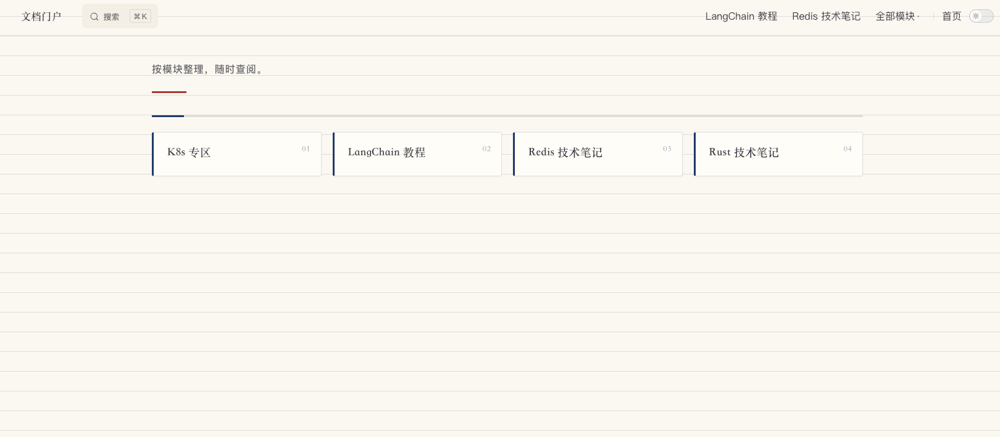

# md2website

把一个 Markdown 文档项目（多章节教程、笔记、课件、手册）改造成静态文档站，并支持一键部署到远程服务器。

**源目录只读**：所有产物写到独立目录，不会改动你的原始 Markdown。




## 在桌面 Agent 里安装

在 Trae CN、Codex、Claude Code 等桌面 Agent 的对话框里，直接发仓库地址并说明意图即可：

```
安装这个技能：https://github.com/binny2026/md2website
```

Agent 会克隆仓库并执行 `./install.sh`。非交互环境下脚本默认装到**所有已检测到的 Agent 技能目录**，因此发起安装的 Agent 也能直接加载。

装完**新开一个会话**（或刷新技能列表）才能看到这个技能。

也可以直接给它一条完整命令：

```bash
git clone git@github.com:binny2026/md2website.git ~/md2website && cd ~/md2website && ./install.sh --all
```

## 功能特性

| 能力 | 说明 |
| --- | --- |
| 自动识别章节 | 按子目录递归扫描，取每篇首个 `H1` 作标题，主文档自动改名为 `index.md` |
| 多级目录 / 合集目录 | 子目录递归成分组侧边栏；多文件目录整组展开逐篇导航 |
| 侧边栏 / 全文搜索 / 代码复制 / 图片放大 | 站点内置能力全部开启 |
| 科技感双主题 | 深色 / 浅色，背景网格 + 光晕，渐变标题与按钮 |
| 语法冲突自动修复 | `<https://...>`、`{{ }}`、`<email_hash:...>`、`` 标签等会被 Vue 误判的写法自动转义 |
| 死链自动改写 | 正文里指向源 `.md` 的相对链接自动改写为站点 URL |
| 一键部署 | 打包 → 上传 → 远程解压 → 校验，支持 SSH 密钥或账号密码 |
| 站点自动登记与更新 | 说「更新站点」即可自动查找并原地重建，多个站点时让你选 |
| 配置隔离 | 服务器信息只存站点目录的 `.deploy-local.yml`（权限 600，不进 git） |
| 门户与子模块 | 用 `--portal` 生成门户聚合多个站点；子模块挂载后门户首页刷新即更新 |

---

## 环境要求

| 依赖 | 版本 | 用途 | 检查 |
| --- | --- | --- | --- |
| Python | 3.8+ | 运行生成脚本（标准库，pypinyin 可选） | `python3 --version` |
| Node.js | **18+** | 构建站点（必需） | `node --version` |
| tar / ssh / scp | 系统自带 | 仅部署需要 | `tar --version` |
| sshpass | 可选 | 用账号密码登录服务器时必需 | `sshpass -V` |
| pypinyin | 可选 | 中文标题转拼音目录名时必需（缺则回退英文） | `python3 -c "import pypinyin"` |

没装 Node.js：

- macOS：`brew install node`，或到 [nodejs.org](https://nodejs.org) 下载
- Ubuntu / Debian：
  ```bash
  curl -fsSL https://deb.nodesource.com/setup_lts.x | sudo -E bash - && sudo apt install -y nodejs
  ```
- Windows：装好 Node.js 后用 **WSL** 或 **Git Bash** 运行

---

## 安装

### 方式一：从仓库安装

```bash
git clone git@github.com:binny2026/md2website.git md2website
cd md2website
./install.sh
```

脚本会先探测本机已安装的桌面 Agent，再让你选择安装到哪些目录：

```
  编号  Agent         路径                         状态
   1    Trae CN       ~/.trae-cn/skills              可安装
   2    Trae          ~/.trae/skills                 未安装该 Agent
   3    Codex         ~/.codex/skills                可安装
   4    Claude Code   ~/.claude/skills               未安装该 Agent
   5    WorkBuddy     ~/.workbuddy/skills            可安装
   6    Custom Path   （安装时输入绝对路径）

选择安装目标 [1-6，空格或逗号分隔，a=全选，q=取消]（回车默认: 1 3 5）:
```

- 支持多选：`1 3 5`、`1,3,5` 或范围 `1-3`
- `a` = 全部安装；`q` = 取消
- **回车 = 更新已安装过的目录**；首次安装（没有任何副本）时默认全部可安装目录
- 未检测到 `skills` 目录的 Agent 会提示并跳过，不会替你在机器上创建目录
- 每个选中的目录各放一份完整 skill，互不影响

非交互场景（Agent 执行、CI、管道）不传参数时，会安装到**所有已检测到的 Agent 目录**（等价于自动 `--all`），
保证发起安装的 Agent 也能加载；只想装一个目录就用 `--dir` 显式指定。

其余参数：

```bash
./install.sh --all              # 安装到所有检测到的 Agent，不交互
./install.sh --list             # 只列出检测结果，不安装
./install.sh --dir <路径>        # 安装到指定目录，可重复传多个
./install.sh --yes              # 跳过安装前的确认
```

安装完成会打印实际位置。**下文示例里的 `~/.workbuddy/skills/md2website` 请替换成你自己的安装路径。**

装好后，用一个真实目录从零跑一遍（复制即可执行）：

```bash
# 1) 安装（见上一节，已在上一步完成）

# 2) 准备一个 Markdown 目录，已有文档就跳过
mkdir -p ~/notes/demo/01-基础
printf '# 第一章\n\n正文内容\n' > ~/notes/demo/01-基础/01.md

# 3) 复制一键入口到文档目录并执行
cp ~/.workbuddy/skills/md2website/assets/build.sh ~/notes/demo/
cd ~/notes/demo
./build.sh --title "我的笔记" --name my-notes

# 4) 浏览器自动打开 http://127.0.0.1:4173
#    站点生成在同级目录：~/notes/demo-site/
#    生成后会询问是否现在配置服务器，选 N 可稍后部署时再配置
```

执行过程中会依次看到环境检查、章节识别、生成站点、安装依赖、构建和预览地址：

```
检查环境 → 扫描章节 → 生成站点 → 安装依赖 → 构建 → 启动预览

✓ 01 第一章 → /01-基础/ (md 1, img 0)
站点目录：/Users/you/notes/demo-site
预览地址：http://127.0.0.1:4173
```

需要调整时：

```bash
# 只生成项目，不装依赖、不构建
./build.sh --no-build

# 构建完不自动打开浏览器
./build.sh --no-open

# 自定义输出目录与副标题
./build.sh --out ~/notes/demo-site --subtitle "学习笔记"
```

确认站点没问题后，可选部署到服务器：

```bash
cd ~/notes/demo-site
# 交互式填写主机、账号、端口、密码或私钥、远程目录、站点根路径（均无默认值）
python3 ~/.workbuddy/skills/md2website/scripts/profile.py wizard --project "$(pwd)"
# 也可以直接执行 ./deploy.sh，缺配置会自动进入向导
./deploy.sh --dry-run   # 先只检查连通性
./deploy.sh             # 构建 + 上传 + 远程解压 + 校验
```

更多参数见下方「使用」章节；首次构建会安装 npm 依赖，通常需要 1–3 分钟。

### 方式二：安装到自定义目录

```bash
./install.sh --dir ~/my-skills/md2website
./install.sh --dir ~/skills-a/md2website --dir ~/skills-b/md2website   # 多个目录
```

`--dir` 传完整的目标目录，可重复；传了就不再进入交互选择。

安装到别处时，把下文命令里的 `~/.workbuddy/skills/md2website` 换成实际路径。

### 安装前后的检查

```bash
./install.sh --check     # 只检查环境（Python / Node 版本），不安装
./install.sh --list      # 列出检测到的 Agent 与安装状态
python3 ~/.workbuddy/skills/md2website/scripts/_env.py   # 安装后再自检一次
```

### 卸载

```bash
./install.sh --uninstall                        # 当前目录是安装副本时，只删这一份
./install.sh --uninstall --dir ~/.workbuddy/skills/md2website   # 显式指定单个目录
./install.sh --uninstall --all                  # 删除所有已检测到的 Agent 副本
```

`--uninstall --all` 只遍历 5 个已知 Agent 目录；用 `--dir` 装到别处的副本需要显式指定路径。
卸载不会删除部署配置档（`~/.workbuddy/deploy-profiles/`），需要时手动清理。

> 仓库里的 `install.sh` 只复制 `SKILL.md`、`scripts/`、`assets/`、文档等必要文件，不会带上 `.git` 与临时产物。

---

## 使用

### 方式一：在 AI Agent 里使用（推荐）

装好并新开一个会话后，直接对 Agent 说「把这个目录做成文档站 / 生成文档站 / 部署文档站到服务器」即可，Agent 会读 `SKILL.md` 执行完整流程。也可以显式指定源目录：

```
Use Skill: md2website /path/to/md目录 生成站点
```

扫描、生成、构建、预览都由 Agent 完成，不需要你手动敲命令。

### 方式二：一键建站（脚本直接跑）

把入口脚本复制到你的 Markdown 目录，双击或执行即可：

```bash
cp ~/.workbuddy/skills/md2website/assets/build.sh ~/你的md目录/
cd ~/你的md目录 && ./build.sh
```

它会自动完成：

```
检查环境 → 扫描章节 → 生成站点 → 安装依赖 → 构建 → 启动预览
```

站点默认生成在同级目录的 `<目录名>-site/`。

常用参数：

| 参数 | 作用 |
| --- | --- |
| `--wizard` | 交互式询问标题、副标题、输出目录，生成后可选配置服务器 |
| `--dir <路径>` | 指定 Markdown 源目录 |
| `--out <路径>` | 指定输出目录 |
| `--title "标题"` | 站点标题 |
| `--subtitle "副标题"` | 站点副标题 |
| `--name "站点名"` | 站点标识名（`package.json` name、部署包名），默认由标题转换 |
| `--skill <路径>` | 手动指定 skill 本体位置 |
| `--no-build` | 只生成项目，不装依赖、不构建 |
| `--no-open` | 构建完不自动打开浏览器 |

示例：

```bash
./build.sh --dir ~/笔记/课程 --out ~/笔记/课程-site --title "我的课程" --name my-course --no-open
```

### 方式三：分步命令行（排错或精细控制）

```bash
SKILL=~/.workbuddy/skills/md2website

# 1) 扫描源目录（只读，不改文件），先看有没有阻断项
python3 $SKILL/scripts/scan.py ~/你的md目录

# 2) 生成站点项目
python3 $SKILL/scripts/init.py ~/你的md目录 \
    --out ~/你的md目录-site \
    --title "站点标题" \
    --subtitle "副标题" \
    --name "site-name"

# 3) 安装依赖并构建
cd ~/你的md目录-site
npm install          # 首次约 1-3 分钟
npm run build

# 4) 本地预览
npm run preview      # http://127.0.0.1:4173
```

`init.py` 参数：

| 参数 | 说明 |
| --- | --- |
| `source` | Markdown 源目录（位置参数） |
| `--out` | 输出目录，必须不存在；默认 `./outputs/md2website-site` |
| `--title` | 站点标题 |
| `--subtitle` | 站点副标题 |
| `--name` | 站点标识名，默认由标题转换 |
| `--base` | 站点根路径，子目录部署填 `/docs/`，默认 `/` |

如果改动了生成后的 Markdown，或手工加了内容导致构建失败：

```bash
python3 $SKILL/scripts/fix.py ~/你的md目录-site/docs            # 修复
python3 $SKILL/scripts/fix.py ~/你的md目录-site/docs --dry-run   # 只看不改
npm run build
```

### 方式四：更新已有站点

源 Markdown 改完后，不需要重新指定路径。直接对 Agent 说「更新站点」「重建站点」「同步站点」，它会自动查找：

```bash
python3 $SKILL/scripts/sites.py list          # 看看有哪些站点
python3 $SKILL/scripts/update.py              # 自动定位；多个站点时让你选
python3 $SKILL/scripts/update.py "<站点目录>" --deploy   # 更新并部署
```

- 站点信息记录在站点目录的 `.md2website.json`，全局登记表在 `~/.md2website/sites.json`
- 更新是原地重建：新增章节自动进侧边栏，覆盖前会把配置备份到 `.backup/`
- `.deploy-local.yml` 与 `node_modules` 会被保留，不用重新配服务器
- 默认只构建不部署，加 `--deploy` 才发布

---

## 部署到服务器

站点目录里已自带 `deploy.sh` 和 `DEPLOY.md`。服务器信息默认只保存在**当前站点目录**的 `.deploy-local.yml`（权限 600，已被 `.gitignore` 忽略），不会提交，也不会随站点上传。

### 首次配置（交互式，支持账号密码）

生成站点时会在终端询问「是否现在配置服务器」，选 `y` 立即进入向导；选 `N` 或非交互环境则跳过，之后首次执行 `./deploy.sh` 时会自动进入同一个向导。

```bash
cd ~/你的md目录-site
python3 ~/.workbuddy/skills/md2website/scripts/profile.py wizard --project "$(pwd)"
```

向导**没有预置默认值**：主机、登录账号、SSH 端口、远程目录、站点根路径都需要手动填写；密码与 SSH 私钥至少填一项。结果写入当前站点目录的 `.deploy-local.yml`，每个站点各自一份。

### 首次配置（配置档方式，多项目共用，可选）

默认不需要配置档。只有多个站点要共用同一台服务器时，才显式创建并绑定：

```bash
PY=python3
SKILL=~/.workbuddy/skills/md2website

# 1) 创建配置档（必填项需全部提供，不会自动补默认值）
$PY $SKILL/scripts/profile.py set --name my-doc \
    HOST="doc.example.com" PORT="22" USER="deploy" \
    REMOTE_DIR="/www/wwwroot/doc.example.com" SITE_BASE="/"

# 2) 项目绑定
$PY $SKILL/scripts/profile.py bind --project "$(pwd)" --name my-doc

# 3) 验证
$PY $SKILL/scripts/profile.py check
./deploy.sh --dry-run
```

### 正式部署

```bash
./deploy.sh                 # 构建 + 上传 + 远程解压 + 校验
./deploy.sh --dry-run       # 只检查配置与连通性，不上传
./deploy.sh --no-build      # 跳过构建，直接上传现有 dist
./deploy.sh --profile other-doc   # 临时换一台服务器
```

配置优先级：

```
--profile 指定 > 站点本地 .deploy-local.yml > 项目绑定 .deploy-profile > 项目内 deploy.conf（旧版）
```

### 登录方式

- **SSH 密钥**：`SSH_KEY` 指向私钥，首次需把公钥装到服务器
  ```bash
  ssh-copy-id -i ~/.ssh/id_ed25519.pub root@doc.example.com
  ```
- **账号密码**：配置 `PASSWORD`，本机需安装 `sshpass`
  ```bash
  brew install sshpass        # macOS
  sudo apt install sshpass    # Debian / Ubuntu
  ```

### 上传形态

| 字段 | 默认 | 说明 |
| --- | --- | --- |
| `DIST_NAME` | `dist` | 产物文件夹名 |
| `UPLOAD_WITH_DIR` | `false` | `true` 时远程生成 `<REMOTE_DIR>/<DIST_NAME>/`；`false` 平铺到 `<REMOTE_DIR>/index.html` |

### 部署后检查 nginx（重要）

站点默认 `cleanUrls: true`，子页面 URL 不带 `.html`。宝塔 / nginx 默认没有回退规则，会出现侧边栏子页面 404。在站点 `server` 块加：

```nginx
location / {
    try_files $uri $uri/ $uri.html /index.html;
}
```

然后 `nginx -s reload`。

### 配置字段

站点本地配置由 `profile.py wizard` 生成，路径固定为当前站点目录下的 `.deploy-local.yml`，权限 `600`。
每个站点一份，互不影响；也支持 `profile.py set` 建配置档后 `cache` 到本地，或手工编辑该文件。
向导与配置档都**不预置默认值**，必填项必须显式提供。

格式规则（解析器是脚本内置的简易 YAML，不是真正的 YAML 库）：

- 字段名大小写等价：`HOST` 与 `host` 都可以，`REMOTE_DIR` 与 `remote_dir` 都可以
- 只支持 `key: value` 单行写法，不支持嵌套、数组、多行字符串
- `#` 可独占一行，也可写在值末尾；只有 `#` 前带空白时才当注释，`abc#def` 这类值会原样保留
- `$HOME` 会被替换为当前用户家目录，可写 `ssh_key: $HOME/.ssh/id_ed25519`
- 值不需要加引号；若值首尾都是引号会被去掉，密码本身首尾有引号时不要再加
- 未知字段会被静默忽略，字段名拼错不会报错，建议改完执行 `./deploy.sh --dry-run` 复核
- `HOST`、`USER`、`REMOTE_DIR`、`PORT`、`SITE_BASE` 五项缺失会直接报错退出

```yaml
# 注释可独占一行，也可写在值末尾
host: doc.example.com
port: 22
user: deploy
password: ""
remote_dir: /www/wwwroot/doc.example.com
ssh_key: $HOME/.ssh/id_ed25519
site_base: /
clean_mode: manifest
build_before_deploy: true
remote_tmp: /tmp
dist_name: dist
upload_with_dir: false
```

最小可用配置（只用 SSH 密钥；五项必填都不能省）：

```yaml
host: doc.example.com
port: 22
user: deploy
remote_dir: /www/wwwroot/doc.example.com
ssh_key: $HOME/.ssh/id_ed25519
site_base: /
```

| 字段 | yml 键 | 必填 | 默认 | 说明 | 备注 |
| --- | --- | --- | --- | --- | --- |
| `HOST` | `host` | 是 | — | 服务器域名或 IP | 只填主机名，不要带 `https://`、端口或路径；示例 `doc.example.com` |
| `USER` | `user` | 是 | — | 登录账号 | 必须手动填写，无默认账号；建议使用只对 `REMOTE_DIR` 有写权限的账号，不要用 `root` |
| `REMOTE_DIR` | `remote_dir` | 是 | — | 远程部署目录（绝对路径） | 必须是站点专属目录，不能是 `/www/wwwroot`、`/var/www`、`/usr/local` 等多站点容器或系统目录；末尾 `/` 会自动去掉；至少两级，如 `/www/wwwroot/域名`；目录不存在不会自动创建，脚本会报错并提示手动 `mkdir -p` |
| `PORT` | `port` | 是 | — | SSH 端口 | 无默认值，必须显式填写（如 `22`）；服务器防火墙 / 安全组需放行；`deploy.sh` 自动用于 `ssh` 与 `scp` |
| `SSH_KEY` | `ssh_key` | 否 | — | SSH 私钥路径 | 无默认值；与 `PASSWORD` 至少填一项；可写 `$HOME`；文件不存在会直接报错；密码登录时留空 |
| `PASSWORD` | `password` | 否 | — | 登录密码 | 明文保存在权限 `600` 的本地文件中；配置后本机必须安装 `sshpass`；与 `SSH_KEY` 至少填一项，两者都空会以禁止交互方式连接并失败；值内 `#` 前无空白时会保留；`#` 前有空白则按注释剥离，含「空格 + `#`」的密码请用引号包裹或改用密钥 |
| `SSH_KEY_PASSPHRASE` | `ssh_key_passphrase` | 否 | — | 私钥口令 | 无默认值；私钥带口令时填写，同样需要本机安装 `sshpass`；与 `PASSWORD` 同时填写时以 `PASSWORD` 为准；`profile.py` 暂不接受该字段，需手工写入 `.deploy-local.yml` |
| `SITE_BASE` | `site_base` | 是 | — | 站点根路径（记录用） | 无默认值，必须显式填写：根目录填 `/`，子目录填 `/docs/`；**不参与构建**，只在部署信息里显示；子目录部署真正生效要在生成站点时执行 `init.py --base /docs/`（`build.sh` 未暴露该参数，需按「方式三」分步执行）；只改这一项不会改变资源路径 |
| `CLEAN_MODE` | `clean_mode` | 否 | `manifest` | 清理方式 | `manifest`：只删除上次部署清单内、本次已不存在的文件，不影响同目录其他程序；`all`：清空 `REMOTE_DIR` 顶层，保留 `.deploy-manifest` 与 `.user.ini`，仅限站点专属目录；`none`：不清理，旧文件会残留；其他取值等同 `none`，不会报错 |
| `BUILD_BEFORE_DEPLOY` | `build_before_deploy` | 否 | `true` | 部署前是否构建 | `false` 等价于 `./deploy.sh --no-build`，适合 CI 已构建、只做上传的场景；命令行显式传 `--build` / `--no-build` 时以命令行为准 |
| `REMOTE_TMP` | `remote_tmp` | 否 | `/tmp` | 远程临时目录 | 必须是绝对路径且账号有写权限；上传包 `<站点名>-<时间戳>.tar.gz` 放这里，解压后立即删除；用共享 `/tmp` 也可以 |
| `DIST_NAME` | `dist_name` | 否 | `dist` | 产物文件夹名 | 只能是单级目录名，允许字母、数字、`.`、`_`、`-`，禁止 `/`、`.`、`..`；`UPLOAD_WITH_DIR=true` 时作为远程子目录名 |
| `UPLOAD_WITH_DIR` | `upload_with_dir` | 否 | `false` | 是否带文件夹上传 | `true`：远程为 `<REMOTE_DIR>/<DIST_NAME>/index.html`，nginx `root` 需指向该子目录；`false`：平铺到 `<REMOTE_DIR>/index.html` |

---

## 安全说明

- **凭据存储**：配置档（`~/.workbuddy/deploy-profiles`，权限 `700`）与站点本地 `.deploy-local.yml`（权限 `600`）均含明文服务器信息，且已被 `.gitignore` 忽略，不会被上传或提交。
- **登录方式**：优先使用 SSH 密钥；只有必须用密码时才配置 `PASSWORD`。脚本通过 `sshpass -e` 从环境变量读取密码，不会把明文密码放进进程命令行。
- **主机指纹**：默认 `StrictHostKeyChecking=accept-new`，首次连接信任并记录主机公钥，之后校验。对安全性要求高的环境，可先手动确认指纹：
  ```bash
  ssh-keyscan -p 22 doc.example.com >> ~/.ssh/known_hosts
  ```
- **清理范围**：默认 `manifest` 模式的清单来自本次上传包内容，部署前只删除上次部署过、现已不存在的文件；目录里其他程序的已有文件不会被接管或删除。`CLEAN_MODE=all` 会清空 `REMOTE_DIR` 顶层，仅保留 `.deploy-manifest` 与 `.user.ini`，请务必使用站点专属目录。
- **账号权限**：建议使用只对 `REMOTE_DIR` 有写权限的部署账号，而不是 `root`；脚本不会执行 `sudo`、不重启服务、不修改 nginx 配置。
- **清理护栏**：`REMOTE_DIR` 必须为绝对路径、至少两级目录，且不能是 `/`、`$HOME`、`/root`、`/etc`、`/var`、`/www`、`/www/wwwroot`、`/var/www`、`/usr/local`、`/tmp`、`/opt` 等系统或多站点容器目录，避免 `CLEAN_MODE=all` 误删。
- **删除护栏**：`build.sh` 拒绝把 `/`、`$HOME`、源目录本身或其父目录作为输出目录。

---

## 脚本职责

| 脚本 | 作用 | 是否改文件 |
| --- | --- | --- |
| `install.sh` | 安装 / 检查 / 卸载 | 写安装目录 |
| `scripts/_env.py` | 探测 Python / Node，给出安装指引 | 只读 |
| `scripts/scan.py` | 检测 Vue 语法冲突、缺失图片 | 只读 |
| `scripts/fix.py` | 修复 `` 标签、错误图片扩展名 | 改写（默认，可 `--dry-run`） |
| `scripts/init.py` | 生成完整文档站项目（含死链改写、多级目录、主题） | 只写新目录，`--force` 时原地重建 |
| `scripts/sites.py` | 查找已生成的站点（`list/select`） | 只读 |
| `scripts/update.py` | 更新已有站点：重建 + 构建，可选部署 | 写站点目录，备份到 `.backup/` |
| `scripts/profile.py` | 部署配置档管理（`path/show/check/set/list/bind/cache/wizard`） | 写 `~/.workbuddy/deploy-profiles/` 或站点 `.deploy-local.yml` |
| `assets/build.sh` | 一键入口：扫描 → 生成 → 装依赖 → 构建 → 预览 | 写输出目录 |
| `assets/deploy.sh` | 构建 + 打包上传 + 远程解压 + 校验 | 写本地临时包 |

---

## 生成的站点结构

```
<输出目录>/
├── docs/
│   ├── index.md                 # 首页
│   ├── .vitepress/
│   │   ├── config.mjs           # 导航 / 侧边栏 / 主题 / 语法转义规则
│   │   ├── theme/
│   │   │   ├── index.mjs
│   │   │   └── custom.css       # 科技感双主题
│   │   └── dist/                # 构建产物
│   ├── <章节>/
│   │   └── index.md
│   └── assets/                  # 图片
├── package.json
├── deploy.sh
├── DEPLOY.md
└── .gitignore                   # 已忽略部署配置与构建产物
```

---

## 常见问题

| 现象 | 原因 | 解决 |
| --- | --- | --- |
| `npm: command not found` | 没装 Node.js | 见「环境要求」 |
| 构建报 `Element is missing end tag` | 正文有裸尖括号 | 勿改 `config.mjs` 的 `markdown.config`；或跑 `fix.py` |
| 构建报 `Rollup failed to resolve import` | 原始 `` 标签 | `python3 scripts/fix.py ./docs` |
| 线上样式全丢、图片全裂 | `SITE_BASE` 与实际路径不符 | 改 `--base` / `SITE_BASE` 后重新构建 |
| 线上子页面 404 | nginx 缺 `try_files` | 见「部署后检查 nginx」 |
| `SSH 连接失败（已禁止交互输入密码）` | 公钥没装到服务器 | 执行 `ssh-copy-id`，或改用 `PASSWORD` 登录 |
| `本机未安装 sshpass` | 配置了密码登录 | `brew install sshpass` / `apt install sshpass` |
| 双击 `index.html` 内链打不开 | 静态文件需 HTTP 服务 | 用 `npm run preview` 或部署后访问 |

更多排错与执行规范见 `SKILL.md`；三步上手版见 `SETUP.md`；English: `README.en.md`。

---

## 许可证

MIT
