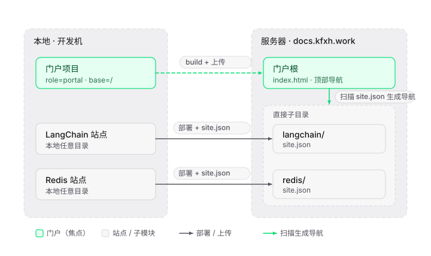

# md2website 门户 + 子模块功能 · 设计文档

- 文档版本：v1.0
- 日期：2026-10-22
- 需求方：用户
- 开发：AI 助手（TraeCode）
- 状态：方案已共识，待实现

---

## 1. 背景与目标

### 1.1 背景

`md2website` 目前把每个 Markdown 项目生成成一个**独立站点**，各自部署到服务器域名根（`SITE_BASE=/`）。当有多个教程/文档站（如 LangChain、Redis）时，它们散落在不同本地目录、部署到不同域名，缺少一个统一的入口。

### 1.2 目标

引入「**门户 + 子模块**」两层模型：

- **门户（主站点）**：一个 VitePress 站点，作为所有子模块的统一入口，顶部导航 + 首页卡片列出子模块。
- **子模块**：现有的 `md2website` 站点，部署到门户路径下的子目录。

核心诉求：

1. 多个散落站点的本地路径互不影响，统一挂到门户。
2. 新增/更新子模块时，门户导航**自动刷新**，无需手动改门户。
3. 未来新增任意站点都能方便地作为子模块挂入。

---

## 2. 现状

| 站点 | 本地路径 | title | base | REMOTE_DIR | 配置机制 |
| --- | --- | --- | --- | --- | --- |
| LangChain | `.../尚硅谷2026LangChain教程站点` | LangChain 教程 | `/` | `/www/wwwroot/redis.kfxh.work`（疑似配置错误） | `.deploy-local.yml` |
| Redis | `.../redis-site` | Redis 技术笔记 | `/` | `/www/wwwroot/redis.kfxh.work` | `.deploy-profile`（旧机制 → redis-doc） |

存在的问题：

1. LangChain 的 `remote_dir` 写成了 Redis 的域名，疑似复制错误。
2. 两个站点 `base` 都是 `/`，挂到门户后必须改为子目录路径（`/langchain/`、`/redis/`），否则入口链接与资源 404。
3. Redis 使用旧配置机制 `.deploy-profile`，需迁移到 `.deploy-local.yml`。

---

## 3. 总体架构

```
本地（开发机）                        服务器 docs.kfxh.work
┌───────────────────┐              ┌──────────────────────────────┐
│ 门户项目 (portal) │──build+上传──▶│ 门户根 index.html + 顶部导航 │
│  LangChain 站点   │──部署+site.json▶│ ┌────────────────────────┐ │
│  Redis 站点       │──部署+site.json▶│ │ langchain/ (site.json)│ │
└───────────────────┘              │ │ redis/     (site.json)│ │
                                   │ └────────────────────────┘ │
                                   └──────────────────────────────┘
                                         ▲ 门户 build 前扫描直接子目录
```



要点：

- 门户 build 前，SSH 扫描服务器门户路径下的**直接子目录**（只认含 `site.json` 的目录），据此生成 `nav`（顶部导航）与首页卡片。
- 子模块本地路径散落任意位置均不影响（门户按服务器目录识别，不依赖本地路径）。

---

## 4. 决策记录（ADR）

| # | 决策点 | 结论 |
| --- | --- | --- |
| D1 | 主站点形态 | VitePress 门户（独立本地项目） |
| D2 | 路径关系 | 子模块 `REMOTE_DIR` 的父目录 = 门户路径（自动推导） |
| D3 | 子模块元数据 | 部署时写 `site.json`（title/description） |
| D4 | 门户构建位置 | 本地 build + 上传 dist |
| D5 | 触发方式 | 自动触发（配 `PORTAL_PROJECT`）+ 手动兜底 |
| D6 | 门户样式 | 复用科技感双主题 |
| D7 | base 联动 | 门户配一次 `SITE_BASE`，子模块自动 = 门户 `SITE_BASE` + 子目录名 |
| D8 | 门户位置 | `docs.kfxh.work`（域名根 `/`） |
| D9 | 门户数量 | 单门户（子模块 0 或 1 个门户），不做多门户 |
| D10 | 配置方式 | 交互式向导 |

---

## 5. 详细设计

### 5.1 目录结构与文件

门户项目（本地，独立目录，`role=portal`）：

```
门户项目/
├── docs/
│   ├── index.md                 # 首页，卡片由 modules.json 生成
│   └── .vitepress/
│       ├── config.mjs           # nav 由 modules.json 生成
│       └── modules.json         # 子模块清单（同步时重写）
├── package.json
└── .deploy-local.yml            # REMOTE_DIR = 门户路径，SITE_BASE = 门户 URL 前缀
```

子模块项目（现有站点目录）：

```
子模块项目/
├── docs/ ...
├── .deploy-local.yml            # 新增 PORTAL_PROJECT + 改写 REMOTE_DIR/SITE_BASE
└── site.json（打包进 dist）      # 部署时写入远程子目录
```

### 5.2 `site.json` 字段

```json
{
  "title": "站点标题",
  "description": "站点副标题"
}
```

- 来源：站点 config 的 `title` / 副标题。
- 打包前放入 `dist`，随产物一起上传，受 `.deploy-manifest` 管理。
- 门户扫描时读取，读不到回退用目录名。

### 5.3 脚本改动

| 脚本 | 改动 |
| --- | --- |
| `scripts/init.py` | 新增 `--portal` 模式，生成门户项目（`role=portal`、`modules.json`、动态 nav/首页） |
| `scripts/profile.py` | 新增 `PORTAL_PROJECT` 字段；新增 `wizard --submodule` 交互向导 |
| `assets/deploy.sh` | 区分角色：子模块上传 dist + 写 site.json + 触发门户重建；门户 build 前扫描子目录生成 modules.json |
| base 自动注入 | 子模块部署时读门户 `SITE_BASE`，算 `base = SITE_BASE + 子目录名` |

### 5.4 配置字段

在 `.deploy-local.yml` 新增：

| 字段 | 必填 | 说明 |
| --- | --- | --- |
| `PORTAL_PROJECT` | 否 | 门户项目本地绝对路径；配置后部署子模块自动重建门户 |

语义：`PORTAL_PROJECT` 为空 = 独立站点（0 个门户）；配置 = 挂载到 1 个门户。

### 5.5 交互式向导

**门户创建**（复用现有 `wizard`）：询问 `HOST` / `USER` / `SSH 端口` / `REMOTE_DIR` / `SITE_BASE`，额外写入 `role=portal`。

**子模块挂载**（新增 `wizard --submodule`）：

| 询问项 | 默认值 |
| --- | --- |
| 门户项目路径 | 交互式选/填 |
| 子目录名 | 站点 `name`（如 `langchain`、`redis`） |

自动推导并写入：`REMOTE_DIR = 门户路径/<子目录名>/`、`SITE_BASE = 门户 SITE_BASE + <子目录名>/`、`PORTAL_PROJECT = 门户项目路径`。

### 5.6 部署流程

**子模块部署**（`./deploy.sh`）：

1. 读配置；有 `PORTAL_PROJECT` 时读门户 `SITE_BASE` 计算自身 `base`。
2. 构建（注入 base）→ 打包（含 `site.json`）→ 上传到 `REMOTE_DIR`。
3. 若配了 `PORTAL_PROJECT`：`cd` 门户项目 → 重建 → 上传门户 dist。

**门户部署**（门户项目内 `./deploy.sh`）：

1. SSH 扫描 `REMOTE_DIR`（门户路径）的直接子目录，读各 `site.json`。
2. 生成 `modules.json` → 重建 `nav`/首页 → 构建 → 上传。

---

## 6. 边界与约束

1. **安全边界**：门户的 `REMOTE_DIR` 即门户路径（父目录），写它属于门户自身部署范围，现有安全护栏已覆盖；子模块写 `site.json` 也在自身子目录内，无越界写父目录。
2. **base 固化**：VitePress 的 `base` 在 build 时固化，一份 `dist` 对应一个 `base`。因此子模块 base 必须在 build 前确定（读门户 `SITE_BASE`）。
3. **单门户**：一个子模块属于 0 或 1 个门户；不做多门户（多门户需处理 base 冲突与多份产物，成本高且当前无需求）。
4. **跨机器限制**：`PORTAL_PROJECT` 存绝对路径，子模块与门户需在同一台机器才能自动触发；跨机器时回退手动在门户机器上跑一次 `./deploy.sh`。
5. **空门户**：首次扫描无子目录时生成仅含首页的空导航。
6. **识别过滤**：门户扫描只认「直接子目录 + 含 `site.json`」，忽略门户自身文件（`index.html`、`assets`、`.deploy-manifest`、`.user.ini`）。

---

## 7. 现有站点迁移方案

| 站点 | 动作 |
| --- | --- |
| LangChain | 修正 `REMOTE_DIR` → `/www/wwwroot/docs.kfxh.work/langchain/`；base 自动 `/langchain/`；写 site.json；配 `PORTAL_PROJECT` |
| Redis | 迁移旧 `.deploy-profile` → `.deploy-local.yml`；`REMOTE_DIR` → `/www/wwwroot/docs.kfxh.work/redis/`；base 自动 `/redis/`；配 `PORTAL_PROJECT` |
| 新增 | 生成门户项目，部署到 `/www/wwwroot/docs.kfxh.work`（base `/`） |

---

## 8. 接口与代码复用说明

- **接口规划**：复用现有 `init.py` / `profile.py` / `deploy.sh`，扩展而非新建；新增 `--portal` 参数与 `wizard --submodule` 子命令。
- **代码复用**：复用 `profile.py` 的 wizard 交互、`deploy.sh` 的 SSH/打包/清单清理逻辑、`init.py` 的科技感主题模板。
- **依赖评估**：复用代码均为本 skill 自有；改动对原有「独立站点」路径保持向后兼容（不配 `PORTAL_PROJECT` 时行为不变）。
- **数据变更**：站点目录新增 `site.json`（进 dist）与 `PORTAL_PROJECT`（进 `.deploy-local.yml`）；无数据库变更。

---

## 9. 测试与验证

- 功能：生成门户、生成子模块、部署后门户导航自动包含子模块。
- base：验证子模块样式/图片无 404（base 正确）。
- 兼容：不配 `PORTAL_PROJECT` 的独立站点部署行为不变。
- 边界：空门户、子模块删除后门户刷新、跨机器手动兜底。

---

## 10. 落地步骤

1. `init.py` 新增 `--portal`。
2. `profile.py` 新增 `PORTAL_PROJECT` + `wizard --submodule`。
3. `deploy.sh` 扩展角色与 base 自动注入、site.json 写入。
4. 生成门户项目并部署到 `docs.kfxh.work`。
5. 迁移 LangChain、Redis 两个站点为子模块。
6. 验证门户导航与子模块资源路径。
